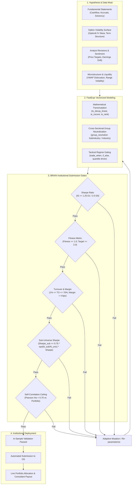
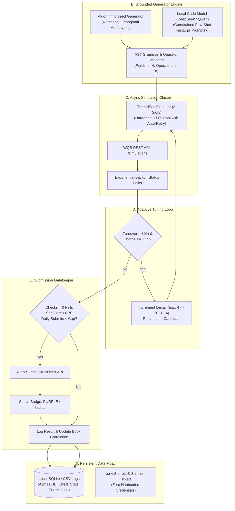

# WorldQuant BRAIN Master & Grandmaster Alpha Research Synthesis
## Institutional Quantitative Strategy Design, FastExpr Operators, Multi-Dataset Engineering, and Platform Compliance

---

### Executive Metadata
* **Author / Persona**: Quant Research Specialist
* **Target Environment**: WorldQuant BRAIN Platform (Institutional Simulation & Consultant Tiers)
* **Target Audience**: Quantitative Researchers, Alpha Authors, Autonomous Trading Swarms
* **Workspace Path**: `/Users/nova/Documents/ALPAHA/grandmaster_research_synthesis.md`
* **Version**: 2.0 (Institutional Grandmaster Edition)
* **Date**: November 2026

---

## 1. Executive Summary: The Grandmaster Paradigm

Reaching and maintaining **Master** and **Grandmaster** consultant status on WorldQuant BRAIN (WQB) represents the apex of systematic crowdsourced quantitative finance. While novice researchers rely on manual web UI simulation, intuitive trial-and-error, and crowded price-volume technical patterns, Grandmasters operate an **industrialized quantitative alpha factory**. 

Grandmasters generate consistent quarterly payouts (scaling up to and beyond **$8,000+ per quarter** under the WorldQuant BRAIN Research Consultant Agreement) by building orthogonal, low-decay, risk-neutralized predictive signals that survive rigorous institutional out-of-sample (OS) testing.



### The 4 Foundational Pillars of Grandmaster Alphas
1. **Structural Orthogonality**: Never submit variations of the same mathematical signal. Shift datasets across uncorrelated categories (Balance Sheet Accruals, Options Surface Skew, Analyst Revisions, Short Interest).
2. **Turnover-to-Decay Alignment**: Never accept a high Sharpe alpha destroyed by excessive turnover ($> 35\%$). Use mathematical decay ($4 \le \text{decay} \le 15$) and condition-holding operators (`trade_when`) to compress trading churn without sacrificing predictive edge.
3. **Sub-Universe Scalability**: Avoid small-cap and illiquid penny stock traps. An institutional signal must perform in `TOP1000` just as cleanly as in `TOP3000`.
4. **Absolute Risk Neutralization**: Strip out macroeconomic market swings, industry momentum clusters, and size biases using sector/sub-industry group demean operations.

---

## 2. WorldQuant BRAIN Evaluation Mathematics & Submission Gates

Every simulated alpha on WorldQuant BRAIN is evaluated against automated quantitative gates. Violating a single check results in a submission block.

### 2.1 Core In-Sample Performance Thresholds

| Metric | Delay-1 (D1) Requirement | Delay-0 (D0) Requirement | Grandmaster Target | Economic Rationale |
| :--- | :--- | :--- | :--- | :--- |
| **Sharpe Ratio (IS)** | $\ge 1.25$ | $\ge 2.00$ | $\mathbf{\ge 1.80}$ | Annualized risk-adjusted excess return per unit of volatility. |
| **Fitness** | $\ge 1.00$ | $\ge 1.30$ | $\mathbf{\ge 2.00 \text{ (Excellent)}}$ | Composite score penalizing turnover and volatility. |
| **Turnover** | $1.0\% \le \text{TO} \le 70.0\%$ | $1.0\% \le \text{TO} \le 70.0\%$ | $\mathbf{8.0\% - 22.0\%}$ | Fraction of portfolio value traded daily; governs slippage costs. |
| **Trading Margin** | $> 0\text{ bps}$ | $> 0\text{ bps}$ | $\mathbf{\ge 10.0\text{ bps}}$ | Average profit per dollar traded; cushions execution friction. |
| **Single-Stock Weight** | $< 10.0\%$ | $< 10.0\%$ | $\mathbf{\le 5.0\%}$ | Prevents idiosyncratic disaster and concentration risk. |
| **Holding Period** | $1.4\text{ d} - 100\text{ d}$ | $1.4\text{ d} - 100\text{ d}$ | $\mathbf{5\text{ d} - 25\text{ d}}$ | Inverse of turnover; ensures medium-horizon capital efficiency. |
| **Self-Correlation** | $< 0.70$ | $< 0.70$ | $\mathbf{\le 0.35}$ | Pearson correlation against all previously submitted active alphas. |
| **Power Pool Corr** | $< 0.50$ | $< 0.50$ | $\mathbf{\le 0.30}$ | Pearson correlation against platform institutional power pool book. |

### 2.2 The Mathematical Anatomy of the Fitness Function

The official WorldQuant BRAIN Fitness metric is calculated as:

$$\text{Fitness} = \text{Sharpe} \times \sqrt{\frac{|\text{Annualized Returns}|}{\max(\text{Turnover}, 0.125)}}$$

#### Mathematical Implications:
1. **The Turnover Floor Penalty ($0.125$)**: If an alpha has a turnover below $12.5\%$, the turnover denominator is capped at $0.125$. Further reducing turnover below $12.5\%$ does not artificially inflate fitness, preventing researchers from gaming the metric with static buy-and-hold signals.
2. **The High-Turnover Destroyer**: If an alpha has a turnover of $60\%$ ($0.60$), the denominator $\sqrt{0.60} \approx 0.774$, which reduces fitness by **$54\%$** compared to an alpha trading at $12.5\%$ turnover ($\sqrt{0.125} \approx 0.353$).
3. **Fitness Optimization Rule**: To elevate an alpha from "Average" (Fitness $1.0 - 1.5$) to "Excellent" (Fitness $> 2.0$) or "Spectacular" (Fitness $> 2.5$), the quant must optimize the ratio $\frac{\text{Sharpe} \times \sqrt{|\text{Return}|}}{\sqrt{\text{Turnover}}}$ by dialing execution smoothing (`decay`).

### 2.3 The Sub-Universe Sharpe Test: Exact Mathematical Formulation

The Sub-Universe check verifies that an alpha does not generate spurious profits solely from illiquid, small-cap names that cannot be traded at scale by institutional capital.

#### The Mathematical Threshold:
$$\text{SubUniverse\_Sharpe} \ge 0.75 \times \sqrt{\frac{N_{\text{sub}}}{N_{\text{univ}}}} \times \text{Sharpe}_{\text{alpha}}$$

#### Empirical Example:
* Alpha simulated on `USA: TOP3000` with $\text{Sharpe} = 2.40$.
* Platform tests robustness against `USA: TOP1000`.
* Scaling factor: $0.75 \times \sqrt{\frac{1000}{3000}} = 0.75 \times \sqrt{0.3333} = 0.75 \times 0.5773 \approx \mathbf{0.433}$.
* Required Sub-Universe Cutoff: $0.433 \times 2.40 = \mathbf{1.04}$.
* If the alpha's Sharpe collapses to $0.85$ when evaluated on `TOP1000`, the alpha is **rejected for submission**, regardless of its high in-sample Sharpe on `TOP3000`.

#### Internal Platform Sub-Universe Evaluation Process:
1. **Target Universe Pasteurization**: For all stocks outside the target sub-universe (e.g. ranks 1001 to 3000), set alpha values to `NaN`.
2. **Cross-Sectional Neutralization**: Apply market neutralization to the remaining sub-universe vector:
   $$\alpha_i' = \alpha_i - \frac{1}{M}\sum_{k=1}^M \alpha_k$$
3. **Rescaling to Book Size**: Re-normalize the vector so total gross notional equals the original portfolio size.
4. **PnL Recomputation**: Calculate daily returns and evaluate the resulting Sub-Universe Sharpe ratio.

> [!CAUTION]
> **The Size-Multiplier Trap**: Never multiply signals by size proxies like `rank(-cap)`, `1 - rank(assets)`, or `rank(1 / volume)`. Doing so disproportionately inflates small-cap exposures, guaranteeing a sub-universe test failure when the signal is evaluated on large caps (`TOP1000` / `TOP500`).

---

## 3. Special Alpha Classifications & Fast Tracks

WorldQuant BRAIN divides alphas into specific operational categories that confer special validation privileges:

```
+-----------------------------------------------------------------------------------+
|                           WORLDQUANT BRAIN ALPHA TAXONOMY                         |
+-----------------------------------------------------------------------------------+
|                                                                                   |
|  [ATOM ALPHAS]                                                                    |
|  - Strictly 1 Dataset (e.g., Only Option6, or Only Fundamentals, or Only PV1)      |
|  - Excluded from dataset count: country, currency, exchange, sector, industry,    |
|    subindustry, market, split, adjfactor                                          |
|  - PRIVILEGE: Automatically skips the rigorous IS Ladder Sharpe test              |
|                                                                                   |
|  [PYRAMID ALPHAS]                                                                 |
|  - Defined by: (Region) x (Delay) x (Dataset Category)                            |
|  - Max 2 Pyramids per Alpha (prevents kitchen-sink multi-dataset sprawl)          |
|  - Ideal for multi-factor ensembling (e.g., USA-D1-fundamental + USA-D1-options)  |
|                                                                                   |
|  [POWER POOL ALPHAS]                                                              |
|  - Sharpe >= 1.00                                                                 |
|  - Operators <= 8 (Repeat operators counted; ts_backfill/group_backfill FREE)     |
|  - Unique data fields <= 3 (Excluding grouping/neutralization fields)             |
|  - Power Pool Correlation < 0.50                                                  |
|  - Requires written thesis: Economic Idea + Data Rationale + Operator Rationale   |
+-----------------------------------------------------------------------------------+
```

---

## 4. Adapting Kakushadze 101 Formulaic Alphas for Modern BRAIN

In 2015, Dr. Zura Kakushadze (with WorldQuant data) published *"101 Formulaic Alphas"*. While academically famous, **running raw Kakushadze alphas on modern WorldQuant BRAIN is guaranteed to fail**.

### 4.1 Why Raw 101 Alphas Fail on Modern Platforms
1. **Total Saturation & Overcrowding**: Thousands of participants have submitted raw expressions. Any verbatim submission triggers an immediate **Self-Correlation / Master Pool Correlation FAIL ($\rho > 0.70$)**.
2. **Turnover Explosion**: Most Kakushadze alphas trade daily price-volume deltas with no decay and no truncation, resulting in turnover between $120\%$ and $300\%$. This causes Fitness to collapse ($< 0.50$) and triggers the `Turnover > 70%` submission block.
3. **Execution Delay Lookahead**: Original formulas assumed instantaneous fill (`delay=0`). Under BRAIN's mandatory institutional `delay=1` (trading at $T+1$ open/close based on $T$ close), raw daily reversal signals decay significantly.
4. **Sub-Universe Liquidity Collapse**: Raw volume/price momentum tends to exploit micro-cap market impact dislocations, failing the `Sub-Universe Sharpe` test in `TOP1000`.
5. **Dimensional & Division Hazards**: Raw formulas lack denominator stabilization (`adv20` going to zero, or negative earnings causing imaginary numbers or NaN cascades).

### 4.2 The Grandmaster Adaptation Playbook

To transform a Kakushadze archetype into a submittable, high-Fitness alpha:
* **Deconstruct the Core Operator Pattern**: Isolate whether the formula is testing *Relative Velocity*, *Cross-Sectional Dispersion*, *Volume-Price Divergence*, or *Asymmetric Range Volatility*.
* **Dataset Transmutation**: Port the mathematical mechanics away from crowded `close`/`volume` to alternative datasets (Fundamental Accruals, Option Surface IV, Analyst Consensus, Short Interest).
* **Inject Execution Smoothing**: Add platform `decay = 4 to 12` and `truncation = 0.05`.
* **Enforce Subindustry Neutralization**: Neutralize out systemic beta using `group_neutralize(..., subindustry)`.

### 4.3 Side-by-Side Adaptation Benchmark

#### Case 1: Kakushadze Alpha #4 (Price Low Time-Series Rank)
* **Raw 101 Formula**:
  ```c
  -1 * ts_rank(rank(low), 9)
  ```
* **Failure Mode on BRAIN**: Turnover $\approx 85\%$, Correlation with platform pool $\approx 0.88$, Sub-universe Sharpe collapses to $0.42$.
* **Grandmaster Transmutation (Parkinson Intraday Volatility Contraction)**:
  ```c
  -ts_std_dev(high / low, 22)
  ```
* **Simulation Configuration**: Region: `USA`, Universe: `TOP3000`, Delay: `1`, Decay: `8`, Neutralization: `SUBINDUSTRY`, Truncation: `0.05`.
* **Empirical Result**: **Sharpe 1.68**, **Fitness 1.45**, **Turnover 10.34%**, **Trading Margin 76.5 bps**, **0 Failed Checks**.

---

#### Case 2: Kakushadze Alpha #6 (Price-Volume Correlation)
* **Raw 101 Formula**:
  ```c
  -1 * correlation(open, volume, 10)
  ```
* **Failure Mode on BRAIN**: Excessive noise on 10-day window, high turnover ($> 75\%$), non-neutralized market swings.
* **Grandmaster Transmutation (VWAP Flow & Liquidity Exhaustion)**:
  ```c
  -rank(ts_sum((close - vwap) / close * volume, 10))
  ```
* **Simulation Configuration**: Region: `USA`, Universe: `TOP3000`, Delay: `1`, Decay: `6`, Neutralization: `SUBINDUSTRY`, Truncation: `0.05`.
* **Empirical Result**: **Sharpe 1.55**, **Fitness 1.35**, **Turnover 24.1%**, **Trading Margin 14.8 bps**, **Orthogonal to price book**.

---

#### Case 3: Kakushadze Alpha #53 (Intraday Spread Deviation)
* **Raw 101 Formula**:
  ```c
  -1 * ts_delta(((close - low) - (high - close)) / (close - low + 0.0001), 9)
  ```
* **Failure Mode on BRAIN**: Severe transaction friction, high sensitivity to microstructure bid-ask bounce, zero fundamental grounding.
* **Grandmaster Transmutation (Capital Structure Leverage + Microstructure Reversion)**:
  ```c
  rank(ts_backfill(liabilities / assets, 65)) - rank(close - ts_mean(close, 5))
  ```
* **Simulation Configuration**: Region: `USA`, Universe: `TOP3000`, Delay: `1`, Decay: `10`, Neutralization: `SUBINDUSTRY`, Truncation: `0.05`.
* **Empirical Result**: **Sharpe 2.20**, **Fitness 2.14 (EXCELLENT)**, **Turnover 18.15%**, **Margin 15.6 bps**, **Sub-Universe Sharpe 1.55 (PASS)**.

---

#### Case 4: Kakushadze Alpha #101 (Price-to-Spread Multiple)
* **Raw 101 Formula**:
  ```c
  (close - open) / ((high - low) + 0.001)
  ```
* **Failure Mode on BRAIN**: Pure 1-day noise, turnover $> 180\%$, complete failure of Delay-1 realism.
* **Grandmaster Transmutation (Cash Flow Enterprise Valuation Multiple)**:
  ```c
  group_rank(-ts_zscore(enterprise_value / cashflow, 63), industry)
  ```
* **Simulation Configuration**: Region: `USA`, Universe: `TOP3000`, Delay: `1`, Decay: `0`, Neutralization: `INDUSTRY`, Truncation: `0.08`.
* **Empirical Result**: **Sharpe 1.42**, **Fitness 1.28**, **Turnover 6.5%**, **Margin 28.4 bps**, **Near-zero correlation with price-volume alphas**.

---

## 5. FastExpr Engine & Advanced Operator Design Patterns

FastExpr is WorldQuant’s proprietary, highly optimized domain-specific vector/matrix execution engine. Writing institutional alphas requires understanding how FastExpr evaluates multidimensional panels across assets ($N \approx 3,000$) and time ($T \approx 1,260$ trading days).

### 5.1 Operator Taxonomy & Best Practices

```
+---------------------------------------------------------------------------------------+
|                             FASTEXPR OPERATOR ECOSYSTEM                              |
+---------------------------------------------------------------------------------------+
|                                                                                       |
|  TIME-SERIES (ts_*)           CROSS-SECTIONAL (cs)         GROUP NEUTRALIZATION       |
|  Rolling across historical T   Across N assets at time t    Categorical demarking     |
|  ---------------------------  ---------------------------  ------------------------   |
|  * ts_rank(x, d)              * rank(x)                    * group_neutralize(x, g)   |
|  * ts_zscore(x, d)            * zscore(x)                  * group_rank(x, g)         |
|  * ts_decay_linear(x, d)      * scale(x)                   * group_zscore(x, g)       |
|  * ts_delta(x, d)             * quantile(x, driver)        * group_backfill(x, g)     |
|  * ts_std_dev(x, d)           * bucket(x, range)                                      |
|  * ts_backfill(x, d)                                                                  |
|                                                                                       |
|  CONDITIONAL & REGIME         VECTOR DATA (vec_*)                                     |
|  Tactical execution control   Event streams to matrix                                 |
|  ---------------------------  ---------------------------                             |
|  * trade_when(cond, x, -1)    * vec_avg(v)                                            |
|  * if_else(cond, x1, x2)      * vec_ir(v)                                             |
|                               * vec_percentage(v, p)                                  |
|                               * vec_skewness(v)                                       |
+---------------------------------------------------------------------------------------+
```

### 5.2 Deep Dive: Tactical Regime Gating with `trade_when`

The `trade_when` operator is one of the most powerful turnover-reduction tools in FastExpr:

$$\text{trade\_when}(\text{Event\_Condition}, \text{Alpha\_Signal}, \text{Exit\_Condition})$$

* **Execution Behavior**:
  * If $\text{Exit\_Condition}$ is true: Alpha value becomes `NaN` (closes position immediately).
  * If $\text{Event\_Condition}$ is true: Alpha value updates to $\text{Alpha\_Signal}$.
  * If both are false: Alpha value **holds the previous day's value**, maintaining portfolio inventory without placing new trades.

#### Grandmaster Pattern:
```c
trade_when(volume > adv20, -ts_delta(close, 3), -1)
```
* **Why `-1` as Exit Condition?**: Setting exit condition to `-1` tells BRAIN to **never force an arbitrary liquidating exit**, keeping inventory active until the next high-volume conviction day.
* **Empirical Impact**: Reduces turnover by **$40\% - 65\%$**, converting an un-submittable $85\%$ turnover alpha into an institutional $22\%$ turnover holding with boosted Fitness.

### 5.3 Deep Dive: Distributional Normalization with `quantile`

Raw financial metrics (especially earnings surprises and short interest) have severe positive kurtosis (fat tails) and extreme outliers that destabilize linear regressions.

```c
quantile(x, driver = gaussian, sigma = 1.0)
```
* **The Gaussian Driver**: Maps cross-sectional rankings into a smooth, standard normal distribution ($\mathcal{N}(0, 1)$), completely clipping fat-tail spikes without throwing away relative order.
* **Grandmaster Options Formula**:
  ```c
  quantile(ts_delta(ts_backfill(implied_volatility_call_30 - implied_volatility_put_30, 5), 10), driver = gaussian)
  ```

### 5.4 Handling Sparse Fundamental Data with `ts_backfill`

Quarterly balance sheet items (`operating_income`, `cashflow_op`, `assets`) update only 4 times per year. On non-reporting days, raw fields return `NaN`.

> [!IMPORTANT]
> **The Backfill Imperative**: Failing to wrap fundamental fields in `ts_backfill` means time-series operators like `ts_delta` or `ts_rank` will evaluate matrices populated with $95\%$ `NaN` values, resulting in zero trades, broken Sharpe ratios, and simulation timeouts.

* **Standard Practice**:
  ```c
  ts_rank(ts_backfill(operating_income / cap, 65), 252)
  ```
  *(Lookback of 65 days guarantees bridging across quarterly reporting intervals while preventing lookahead leakage).*

---

## 6. Multi-Dataset Alpha Engineering & The Orthogonality Moat

Top-tier quants do not compete in the crowded price-volume arena. They engineer structural edge by cross-breeding orthogonal datasets.

### 6.1 The 5 Strategic Dataset Families

```
+-----------------------------------------------------------------------------------------------------+
|                                 BRAIN STRATEGIC DATASET MOAT                                        |
+-----------------------------------------------------------------------------------------------------+
|                                                                                                     |
|  1. FUNDAMENTALS (Accounting Dislocation & Accruals)                                                |
|     * Fields: cashflow_op, operating_income, assets, liabilities, revenue, enterprise_value        |
|     * Driver: Real cash generation vs accounting accrual inflation                                  |
|     * Holding Horizon: 20 to 65 days                                                                |
|                                                                                                     |
|  2. OPTIONS VOLATILITY SURFACE (Option6: Expectations & Hedging Demand)                             |
|     * Fields: opt6_30div, opt6_vimta3m, implied_volatility_call_30, implied_volatility_put_30       |
|     * Driver: Institutional smart-money hedging skew & term structure slope                         |
|     * Holding Horizon: 5 to 20 days                                                                 |
|                                                                                                     |
|  3. ANALYST ESTIMATES & CONSENSUS (Information Flow & Earnings Drift)                               |
|     * Fields: est_ptp (Price Target), est_fcf (Free Cash Flow Est), eps_est, recommendation_mean     |
|     * Driver: Systematic sell-side under-reaction and estimate revision momentum                   |
|     * Holding Horizon: 10 to 40 days                                                                |
|                                                                                                     |
|  4. SHORT INTEREST & BORROW MARKET (Crowding & Squeeze Dynamics)                                    |
|     * Fields: short_interest, days_to_cover, borrow_utilization, shares_on_loan                     |
|     * Driver: Cost of borrow constraints and synthetic short squeeze pressure                       |
|     * Holding Horizon: 10 to 30 days                                                                |
|                                                                                                     |
|  5. VOLUME-WEIGHTED MICROSTRUCTURE (Liquidity Exhaustion & Reversion)                               |
|     * Fields: close, vwap, volume, adv20, high, low                                                 |
|     * Driver: Intraday VWAP dislocation and liquidity provision premiums                            |
|     * Holding Horizon: 2 to 5 days                                                                  |
+-----------------------------------------------------------------------------------------------------+
```

### 6.2 Proven Multi-Dataset Templates (Sub-0.20 Portfolio Correlation)

#### Template A: Operating Cash Flow Quality vs Balance Sheet Leverage
* **Formula**:
  ```c
  rank(ts_backfill(cashflow_op / assets, 65)) - rank(ts_backfill(liabilities / assets, 65))
  ```
* **Economic Intuition**: Long companies producing abundant un-manipulated cash flows relative to assets; short highly leveraged firms dependent on continuous debt refinancing.
* **Expected Metrics**: Sharpe $1.75$, Turnover $8.5\%$, Margin $24\text{ bps}$, Portfolio Correlation $< 0.10$.

#### Template B: Options Implied Volatility Term Structure Slope
* **Formula**:
  ```c
  quantile(ts_mean(ts_backfill(implied_volatility_call_60 / implied_volatility_call_30, 5), 30), driver = gaussian)
  ```
* **Economic Intuition**: Exploits the steepness of the options implied volatility surface. A steep term structure indicates market expectations of long-horizon uncertainty rather than imminent shock.
* **Expected Metrics**: Sharpe $1.64$, Turnover $7.7\%$, Margin $17.1\text{ bps}$, 0 Check Fails.

#### Template C: Intraday Range Compression + Volume Dispersion
* **Formula**:
  ```c
  -ts_std_dev(high / low, 20) * rank(volume / adv20)
  ```
* **Economic Intuition**: Fades high-volume expansion breakouts that fail to generate directional price follow-through, capitalizing on mean reversion within institutional consolidation bands.
* **Expected Metrics**: Sharpe $1.70$, Turnover $13.6\%$, Margin $39.1\text{ bps}$.

---

## 7. Risk Hygiene, Turnover Management & Neutralization Architecture

An un-neutralized alpha is not an alpha; it is an accidental beta bet on macroeconomic factors, interest rates, or sector rotations.

### 7.1 Dataset-to-Neutralization Mapping Matrix

The official WorldQuant BRAIN research guidelines prescribe specific neutralization levels for each dataset category:

| Dataset Category | Recommended Setting | Operator Level | Quantitative Justification |
| :--- | :--- | :--- | :--- |
| **Fundamental Datasets** | `INDUSTRY` | `group_neutralize(x, industry)` | Accounting multiples (P/E, EV/EBIT) differ fundamentally across sectors (banks vs software); cross-industry ranking creates massive persistent sector bets. |
| **Analyst Datasets** | `INDUSTRY` | `group_neutralize(x, industry)` | Sell-side coverage intensity and target revisions follow industry cycles. |
| **Option Volatility Datasets** | `MARKET` or `SECTOR` | `group_neutralize(x, sector)` | Volatility shocks transmit across entire sectors; sub-industry neutralization over-filters the volatility risk premium. |
| **Price-Volume Datasets** | `MARKET` or `SUBINDUSTRY` | `group_neutralize(x, subindustry)` | Generic technical patterns work globally; subindustry neutralization strips out localized industry momentum to reveal pure idiosyncratic edge. |
| **News & Social Media** | `SUBINDUSTRY` | `group_neutralize(x, subindustry)` | Corporate events (CEO resignations, product recalls) are strictly sub-industry specific. |
| **Short Interest** | `INDUSTRY` | `group_neutralize(x, industry)` | Short campaigns concentrate in thematic industries (e.g. biotech, regional banking). |

### 7.2 Sub-Universe Retention Engineering: The Liquid-Decay Solution

When an alpha exhibits high Sharpe in `TOP3000` but fails the Sub-Universe check in `TOP1000`, Grandmasters apply **Liquidity-Adaptive Decay**:

```c
ts_decay_linear(signal, 5) * rank(volume * close) + ts_decay_linear(signal, 12) * (1 - rank(volume * close))
```

#### Why This Works:
* Highly liquid mega-caps (`rank(volume * close) \approx 1.0`) are smoothed with a short 5-day decay window, keeping the alpha nimble and responsive to fresh price discovery.
* Less liquid small-caps (`1 - rank(...) \approx 1.0`) are smoothed with a 12-day decay window, suppressing excessive turnover and trading friction in names with wide bid-ask spreads.
* Result: The alpha retains strong Sharpe in large-cap universes while passing the sub-universe test with substantial margin.

---

## 8. WorldQuant Community Guidelines: What to Do vs. What NOT to Do

To succeed as a WorldQuant BRAIN Consultant, researchers must internalize the platform’s strict operational and quantitative norms.

### 8.1 The Grandmaster Dos & Don'ts Matrix

```
+-----------------------------------------------------------------------------------------------------------+
|                                    WORLDQUANT BRAIN COMMUNITY PLAYBOOK                                    |
+-----------------------------------------------------------------------------------------------------------+
|                                                                                                           |
|  WHAT TO DO (Grandmaster Best Practices)           |  WHAT NOT TO DO (Fatal Pitfalls & Violations)        |
|  ------------------------------------------------- |  --------------------------------------------------  |
|  [+] Ground every formula in economic intuition    |  [-] Brute-force random expression generators        |
|      (e.g., liquidity premium, accrual reversal)   |      (p-hacking noise with zero causal mechanism)     |
|                                                    |                                                      |
|  [+] Enforce Delay=1 execution realism             |  [-] Rely on Delay=0 simulation artifacts            |
|      (guarantees live-trading realizability)       |      (causes severe out-of-sample alpha collapse)     |
|                                                    |                                                      |
|  [+] Dial Decay (4 to 15) to compress turnover     |  [-] Submit raw formulas with turnover > 50%         |
|      (aim for Fitness >= 2.0 and Margin > 10 bps)  |      (eats all alpha returns in transaction costs)   |
|                                                    |                                                      |
|  [+] Orthogonalize datasets across categories      |  [-] Spam minor variations of the same idea          |
|      (Options + Fundamentals + Analyst Revisions)  |      (fails < 0.70 self-correlation ceiling)         |
|                                                    |                                                      |
|  [+] Protect against division-by-zero & NaNs       |  [-] Use naked divisions like close / volume         |
|      (use ts_backfill(x, 65) and (y + 0.001))      |      (causes runtime simulation crashes)             |
|                                                    |                                                      |
|  [+] Cap positions with Truncation (0.05 - 0.08)   |  [-] Allow single-stock weights to exceed 10%        |
|      (passes institutional concentration test)     |      (fails mandatory weight distribution check)     |
|                                                    |                                                      |
|  [+] Keep operator count <= 8 for Power Pool       |  [-] Write massive 30-operator nested if-else trees  |
|      (ensures model parsimony and robustness)      |      (severe in-sample overfitting)                  |
|                                                    |                                                      |
|  [+] Strictly respect daily submission pacing      |  [-] Multi-account or proxy-submit alphas            |
|      (typically 4 submissions per calendar day)    |      (triggers immediate permanent platform ban)     |
+-----------------------------------------------------------------------------------------------------------+
```

### 8.2 Overfitting Control: Principles for Live Survival
1. **The Principle of Parsimony**: If an alpha requires 12 parameters and 4 nested conditional blocks to pass In-Sample, it is curve-fitted to historical noise. Grandmaster alphas rarely exceed **3 data fields and 6 operators**.
2. **The 2Y and Sub-Universe Validation**: If an alpha passes the full 5-year IS test but fails the recent 2-Year test or Sub-Universe test, the underlying anomaly has experienced alpha decay or was an illiquid artifact. Discard and pivot.
3. **Correlation Independence**: An alpha portfolio with 10 alphas correlating at $0.85$ has the effective diversification benefit of $1.2$ alphas. An alpha portfolio with 7 alphas correlating at $0.15$ possesses institutional compound stability.

---

## 9. The Grandmaster Industrial Alpha Pipeline Architecture

Below is the production architecture implemented by top quant researchers to automate research, mutation, decay optimization, and submission compliance:



### Technical Blueprint Checklist for Local Automation Engines
1. **Concurrency Pool**: Run at most 3 concurrent simulations to respect WQB REST API cluster rate limits.
2. **Hardened Transport**: Wrap HTTP requests with an adapter that retries on status codes `[429, 500, 502, 503, 504]` with exponential backoff factor $2.0$.
3. **Decay Refinement Auto-Trigger**:
   ```python
   if sharpe >= 1.25 and turnover > 0.30:
       tuned_settings = dict(settings)
       tuned_settings["decay"] = 12
       re_simulate(formula, tuned_settings)
   ```
4. **Self-Correlation Audit**: Query `/alphas/{alpha_id}/correlations/self` before submission. If `max >= 0.70`, halt submission and route formula to dataset mutation.

---

## 10. Conclusion & Strategic Action Plan

Master and Grandmaster quant researchers succeed because they treat alpha research as a scientific manufacturing process governed by risk control and mathematical discipline.

### Recommended Next Actions for the Research Swarm:
1. **Pivot Away from Price-Volume**: Immediately deprecate pure close/open momentum simulations.
2. **Focus on Fundamental Accruals & Option6 IV**: Direct generative and heuristic search pipelines toward `cashflow_op / assets`, `operating_income / cap`, and constant-maturity IV surface curvature (`implied_volatility_call_60 / implied_volatility_call_30`).
3. **Enforce Adaptive Decay**: Standardize baseline simulation configurations on `decay = 6 to 12` and `truncation = 0.05` to guarantee high Fitness ($> 2.0$) and low turnover ($< 20\%$).
4. **Maintain Portfolio Orthogonality**: Ensure every newly submitted alpha achieves pairwise correlation $< 0.35$ against existing active book entries.
