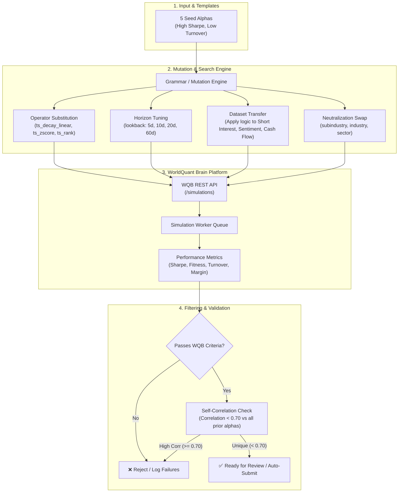

# WorldQuant Brain: Automated Alpha Generation & Mining Pipeline

> [!WARNING]
> **Account Security First**: Never share your WorldQuant Brain credentials, passwords, or raw session tokens. Automated pipelines should always run on your local machine or private server using environment variables (`.env`).

---

## 1. Executive Summary

**Question:** *Can an automated continuous pipeline use 5 submitted seed alphas to iteratively discover, simulate, and submit ~20 new valid alphas on WorldQuant Brain (WQB)?*

**Answer:** **Yes.** Using the official WorldQuant Brain REST API, you can build a local mutation and simulation loop. Rather than brute-force random guessing (which has a near 0% success rate), an automated mining engine takes the economic intuition of your 5 successful alphas and applies structured mathematical mutations, dataset transfers, and parameter optimization.

---

## 2. Architecture Overview



---

## 3. How the Engine Works

### Step 1: Alpha Decomposition
Break down each seed alpha into its structural components:
- **Data Field**: Price/Volume (e.g., `returns`, `volume`, `close`) vs. Fundamental vs. Alternative data.
- **Time-Series Operator**: e.g., `ts_rank(x, d)`, `ts_decay_linear(x, d)`, `ts_zscore(x, d)`.
- **Cross-Sectional Operator**: e.g., `rank(x)`, `zscore(x)`.
- **Grouping & Neutralization**: e.g., `group_neutralize(x, subindustry)`.

### Step 2: Intelligent Mutation Strategies
Instead of random text generation:
1. **Horizon Exploration**: If a signal works at $d=20$, test $d \in \{5, 10, 15, 30, 45, 60\}$.
2. **Operator Alternation**:
   - Swap `ts_mean` with `ts_decay_linear` to give higher weight to recent signals.
   - Swap `ts_rank` with `ts_zscore` to preserve magnitude information.
3. **Dataset Transfer**:
   - Take the mathematical logic of a price momentum alpha and apply it to alternative datasets (e.g., analyst estimate revisions, short squeeze indicators, sentiment scores, ESG ratings).
4. **Conditional Transformations**:
   - Gate signals using market regimes (e.g., only trigger when volatility is below a moving average threshold).

### Step 3: Simulation via REST API
Using `https://api.worldquantbrain.com`:
- Authenticate via session tickets or bearer tokens stored in a local `.env` file.
- Dispatch simulation payloads with configuration settings:
  - **Universe**: e.g., `TOP3000`, `TOP1000`
  - **Delay**: `1`
  - **Neutralization**: `SUBINDUSTRY`
  - **Decay**: `0` to `4`
  - **Truncation**: `0.08`
- Poll until status is `COMPLETED`.

### Step 4: Multi-Stage Filtering
To ensure candidates are eligible for submission:
* **Sharpe Ratio**: $\ge 1.25$ (often $\ge 1.5$ preferred for safety).
* **Fitness**: $> 1.0$.
* **Turnover**: Between $1\%$ and $70\%$.
* **Sub-Universe / Region Consistency**: Positive returns across different market regimes.
* **Low Self-Correlation**: Correlation matrix calculated across your entire existing alpha portfolio must show pairwise correlation $< 0.70$.

---

## 4. Key Platform Constraints to Account For

> [!IMPORTANT]
> - **API Rate Limits & Concurrent Workers**: WorldQuant Brain restricts how many simulations can run concurrently (usually 3 to 5 depending on user level). The script must use queue management and exponential backoff (`429 Too Many Requests`).
> - **Daily Simulation Caps**: Avoid exhausting your daily quota by dry-testing logic or keeping simulation queues prioritized.
> - **Platform-Wide Correlation**: Even if an alpha does not correlate with your own 5 alphas, WQB will reject submission if it correlates with alphas already in their master institutional pool. Dataset transfer (using less crowded alternative datasets) is the highest-probability way around this.

---

## 5. Recommended Implementation Plan

1. **Keep Secrets Local**: Run the pipeline locally or on a personal cloud VPS. Store credentials in `.env`:
   ```bash
   BRAIN_EMAIL="your_email@domain.com"
   BRAIN_PASSWORD="your_password"
   ```
2. **Local Tracking Database**: Use a local SQLite database (`alphas.db`) to record:
   - Alpha ID and formula expression
   - Simulation metrics (Sharpe, Turnover, Fitness, Drawdown, Margin)
   - Status (`FAILED`, `PASSED_METRICS`, `SUBMITTED`, `DUPLICATE`)
3. **Review Before Submission**: Set the pipeline to alert you (via Discord/Telegram/Terminal webhook) when an alpha passes all criteria, allowing a human-in-the-loop final review before submitting.
